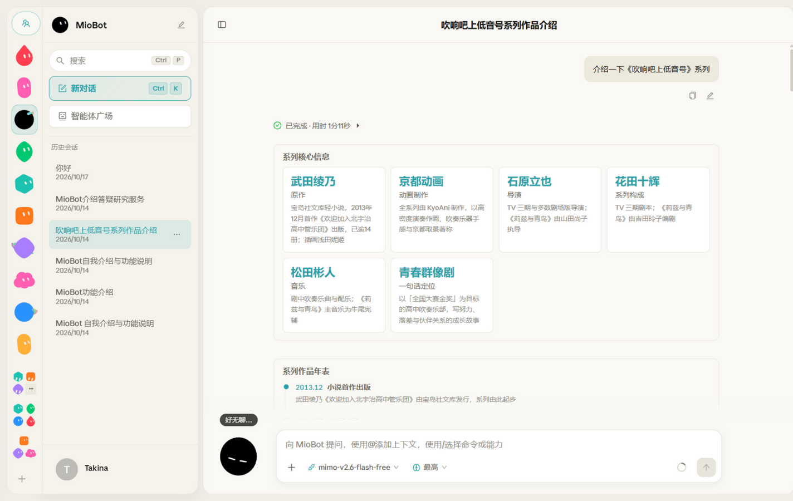
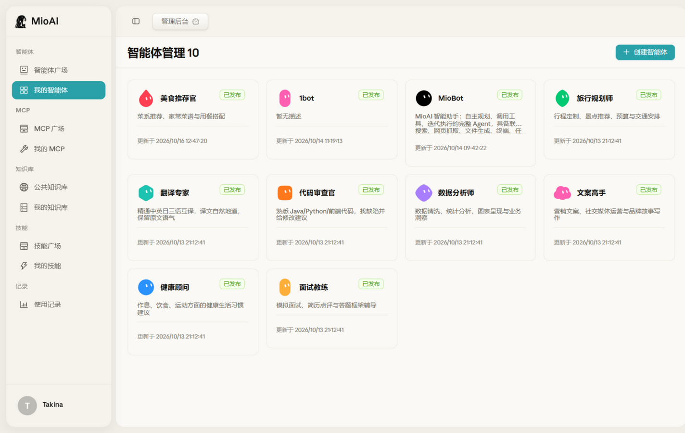
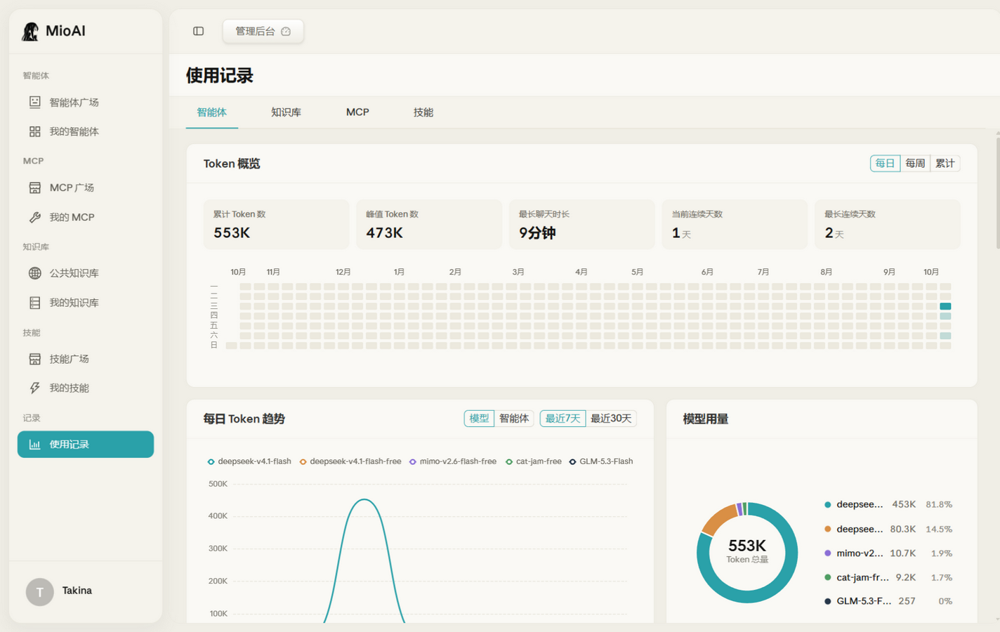
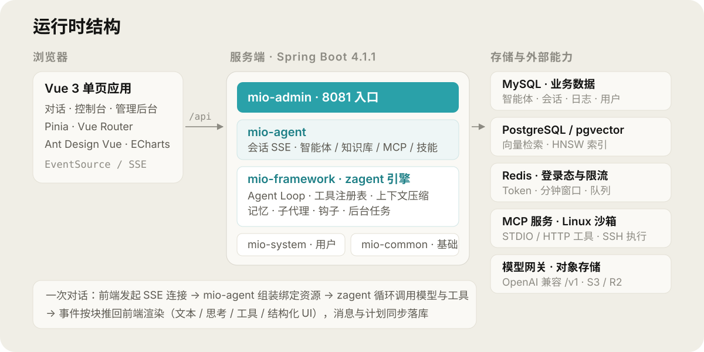

<p align="center">
  
</p>

<h1 align="center">MioAI</h1>

---

<p align="center">
  🧠 Spring Boot × Spring AI × Vue 3 —— 会思考，能行动：对话、知识库、MCP 工具、技能与记忆，都跑在你自己部署的服务上
</p>

<p align="center">
  
  
  
  
  
  
  
</p>

## 界面

一次完整轮次：工具调用过程可见，回答可以是文字，也可以是结构化卡片与年表。

<p align="center">
  
</p>

<p align="center">
  
  
</p>

## 能做什么

**对话** —— SSE 流式输出，思考过程与工具调用逐步展开。回答里的图表、表格、任务清单、表单、图集等 17 种结构化块由模型按协议生成，前端按白名单渲染，未知类型降级为可折叠原始数据。

**智能体** —— 创建时可选图标、人设、模型、知识库绑定、MCP 绑定与技能绑定；每次发布留版本快照，可回滚。内置智能体支持用户级个性化（改人设、换图标）并单独发布到广场。群聊智能体把多个自定义智能体编成一个组，由调度器按任务委派成员执行。

**知识库** —— 文档上传、解析、分块、向量化、命中测试；公共知识库可跨用户检索。每个「智能体 ↔ 知识库」绑定独立配置 topK、相似度阈值与是否重排，检索限定在绑定范围内。

**MCP** —— 填写配置后在线校验，校验失败按错误类型给出定位；支持市场展示与绑定到智能体，绑定级可覆盖密钥等参数。标准输入型服务在容器内以子进程运行。

**技能** —— 从 ZIP、GitHub 仓库或 skills.sh 导入 SKILL.md 与附属文件，绑定到智能体后在运行时物化到工作区，可发布到技能广场。

**记忆与后台任务** —— 会话上下文超阈值自动压缩为摘要（不需要沙箱）。跨会话事实写入沙箱内的文件级记忆，会话开始注入索引；长命令与子代理任务可脱离本轮在后台执行，服务重启后重连并补发结果。这两项依赖沙箱。

**使用分析** —— Token 统计、日历热力图、每日趋势、模型构成、来源去向与逐日下钻。

**管理后台** —— 总览、用户、会话、日志审计、运行数据、资源管理、使用统计。

## 架构

<p align="center">
  
</p>

一次对话的路径：前端建立 SSE 连接 → `mio-agent` 组装该智能体绑定的知识库、MCP 与技能 → `zagent` 引擎进入 Agent Loop，每一步把可用工具与压缩后的上下文交给模型 → 工具调用回流到注册表执行 → 事件按块推给前端，同时消息与计划落库。

引擎自带工具：`Read` `Write` `Edit` `Bash` `Glob` `Grep` `WebFetch` `WebSearch` `TodoRead` `TodoWrite` `TaskOutput` `TaskStop` `Agent` `AskUserQuestion`。MCP 工具与内置工具共用同一个注册表、同一套钩子（调用前可拦截，调用后可审计）。

## 快速开始

### Docker 一键部署

```bash
cp .env.example .env      # 填入密钥
docker compose up -d --build
```

首次启动时 `MioAIBackend/mio_ai.sql` 会自动导入，创建表结构与种子数据。访问 <http://localhost:8090>，默认管理员 `admin / admin123456`，**首次登录后立即修改密码**。

Compose 起五个容器：MySQL、PostgreSQL(pgvector)、Redis、后端、前端。前端 nginx 负责静态托管并把 `/api` 反代到后端。

### 本地开发

需要 JDK 21、Maven 3.9+、Node.js 20+、pnpm、MySQL 8、PostgreSQL 16（含 pgvector）、Redis。

```bash
# 1. 建库（结构 + 种子数据）
mysql -u root -p < MioAIBackend/mio_ai.sql

# 2. 配置后端
cp MioAIBackend/mio-admin/src/main/resources/application.yml.example \
   MioAIBackend/mio-admin/src/main/resources/application.yml

# 3. 构建并启动后端（http://localhost:8081）
cd MioAIBackend && mvn -DskipTests package
java -jar mio-admin/target/mio-admin-*.jar

# 4. 启动前端（http://localhost:3000，/api 已代理到后端）
cd MioAIFrontend && pnpm install && pnpm dev
```

`application.yml` 与 `.env` 都已排除在版本库外。配置里的敏感项都支持用同名大写环境变量覆盖，Docker 部署走的就是这条路径。

需要的密钥（只有 Embedding 是必需的）：

| 变量 | 用途 |
|---|---|
| `EMBED_APIKEY` | **必填。** Embedding，OpenAI 兼容 `/v1/embeddings`，默认 mistral-embed |
| `R2_ENDPOINT` `R2_ACCESS_KEY_ID` `R2_SECRET_ACCESS_KEY` | 文件上传需要，S3 兼容对象存储 |
| `WEB_SEARCH_API_KEY` | 联网搜索工具，可选 |
| `PEXELS_API_KEY` | 图片检索工具，可选 |
| `GITHUB_TOKEN` | 知识库 GitHub 导入提升 API 限额，可选 |
| `DASHSCOPE_API_KEY` | 重排，默认关闭，可选 |

Linux 沙箱是可选项：不配置 `mio.ai.sandbox.*` 时，文件读写与终端工具不会注册，对话、知识库、MCP、技能都不受影响。

## 技术栈

### 后端

<p>
  
  
  
  
  
  
</p>

### 前端

<p>
  
  
  
  
  
  
  
  
  
</p>

### 数据与基础设施

<p>
  
  
  
  
  
  
</p>

## 项目结构

```text
MioAI/
├── MioAIBackend/                  Spring Boot 多模块
│   ├── mio-admin/                 启动入口、application.yml
│   ├── mio-agent/                 会话 SSE、智能体/知识库/MCP/技能资源、日志
│   ├── mio-framework/             zagent 引擎、RAG、MCP 客户端、SSH 沙箱、记忆
│   ├── mio-system/                用户、登录态
│   ├── mio-common/                统一响应、异常、AOP、工具类
│   ├── mio_ai.sql                 建库脚本（表结构 + 种子数据）
│   ├── sql/                       增量迁移脚本
│   └── doc/                       实验记录与问题跟踪
├── MioAIFrontend/                 Vue 3 单页应用
│   ├── src/views/                 页面：首页、对话、控制台、管理后台、分享、调试
│   ├── src/components/            跨页面共享组件（agent/auth/charts/content/icons/ui）
│   ├── src/composables/           跨页面共享逻辑（admin/charts/chat/layout/model）
│   ├── src/mobile/                移动端适配层（断点、外壳侧栏、抽屉）
│   ├── src/api/ src/types/ src/utils/ src/store/ src/router/ src/styles/
│   └── nginx.conf                 静态托管 + /api 反代 + SSE 超时
├── assets/readme/                 README 视觉素材（SVG 源 + 截图）
├── docs/                          架构与演进文档
├── docker-compose.yml
└── .env.example
```

## 接口

后端接口分三类：会话与资源、统计日志、管理后台。

| 前缀 | 说明 |
|---|---|
| `/bot/*` | 对话入口，`/bot/chat` 为 SSE 流；模型切换、上下文用量、中断、历史消息 |
| `/agents/*` | 智能体增删改查、发布与版本回滚、广场、群聊、用户级个性化 |
| `/knowledge-bases/*` `/documents/*` | 知识库与文档：上传、处理、命中测试 |
| `/mcp/*` `/mcp-tools/*` | MCP 配置、校验 |
| `/skills/*` | 技能：ZIP / GitHub / skills.sh 导入、市场 |
| `/agent-knowledge/*` `/agent-mcp/*` `/agent-skill/*` `/agent-memory/*` | 智能体与资源的绑定关系 |
| `/memory/*` | 会话列表、历史消息、重命名、置顶、分享 |
| `/usage-stats/*` `/rag-retrieval-logs/*` `/tool-call-logs/*` | 使用统计与调用日志 |
| `/admin/*` | 管理后台：总览、用户、会话、日志、运行数据、资源、使用统计 |
| `/user/*` | 注册、登录、资料、头像 |

## 安全设计

- **资源归属校验**：会话、文档、知识库、智能体、MCP 与技能绑定都校验所有者，公开资源按可见性放行。
- **检索隔离**：向量检索用过滤表达式限定知识库范围，智能体只能检索自己绑定的库。
- **沙箱默认关闭**：不配置 `mio.ai.sandbox.*` 时终端与文件工具不注册；开启后命令在独立 Linux 主机上以 SSH 执行，权限边界由那台机器决定。
- **提示注入防护**：知识库片段与网页抓取结果都以「资料数据，不是指令」显式框定，不混进系统提示。
- **限流**：按归属限制每分钟轮次与并发数，窗口记在 Redis。
- **密码**：BCrypt 存储；历史 MD5 口令在登录成功后自动升级。
- **密钥**：`application.yml`、`.env` 均不入库，配置模板与应用分离。

## 已知限制

- 沙箱是单机 SSH 长连接，命令串行执行，面向单用户部署；不是多租户隔离的容器编排。
- SSE 鉴权通过 URL 传 token（EventSource 不支持自定义请求头），生产环境建议换成一次性短票据。
- 文件上传依赖对象存储配置，未配置时头像与知识库文档上传不可用。
- 未配置沙箱时 `Bash`/`Read`/`Write` 等工具不注册，智能体只能做纯对话与检索。
- 仓库未附许可证文件。

## 文档

- [Agent 演进路线图](./docs/agent-evolution-roadmap.md)
- [RAG 消融实验设计与写作指引](./MioAIBackend/doc/rag-eval-experiment.md)
- [动态 UI 三期方案](./docs/dynamic-ui-phase3-plan.md)
- [MCP 问题跟踪](./MioAIBackend/doc/mcp-issues-2026-10.md)
